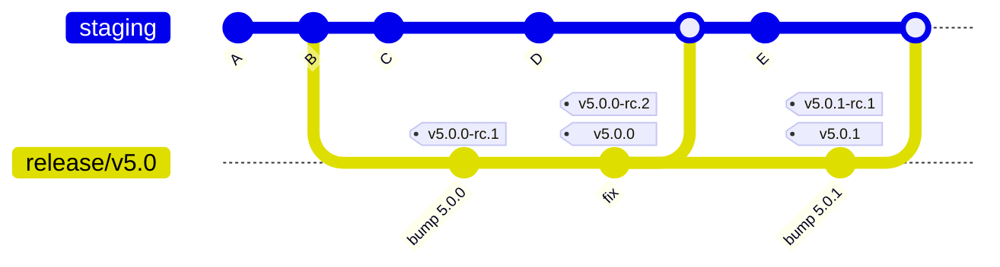

# Branching and Releasing

snarkOS uses trunk-based development, like [snarkVM](https://github.com/aleo-labs-protocol/snarkVM/blob/staging/BRANCHING_AND_RELEASING.md). `staging` is the trunk. Each release is made on its own release branch, cut from `staging`.

## Branches

| Branch | Purpose |
| :- | :- |
| `staging` | The trunk. All feature work targets it. |
| `release/vX.Y` | One branch for each minor release, for example `release/v5.0`. Patch releases (`v5.0.1`) come from the same branch. |

The `mainnet`, `testnet` and `canary` branches are no longer updated. The network is a runtime flag (`--network`), not a branch: one release commit runs on testnet first, then on mainnet.

## Tags and releases

| Tag | GitHub | Network |
| :- | :- | :- |
| `vX.Y.Z-rc.N` | Pre-release | testnet |
| `vX.Y.Z` | Release | mainnet |

- Release tags are made only on release branches.
- A final tag `vX.Y.Z` goes on the accepted release candidate's commit, or on one that differs from it only in Cargo manifests, when the final pins snarkVM's published release. mainnet runs the code that testnet accepted.
- Never move or delete a release tag.
- Tags of the form `testnet-vX.Y.Z` come from the old process.

## Running a release

To build what runs on a network, check out its latest release tag:

```bash
./scripts/checkout-latest-release.sh mainnet
./scripts/checkout-latest-release.sh testnet
```

This replaces `git checkout mainnet` and `git pull`. The script asks GitHub for the newest release, checks out its tag, and prints the commit. It leaves git on a detached HEAD, so rerun it to update. The `scripts/run-*.sh` scripts run what is checked out and no longer pull. It needs `curl` and `jq`.

## CI

Pull requests that target a `release/**` branch, and pushes to a `release/**` branch, run the merge and release jobs in addition to the normal CI, and `ci-ok` fails if one is skipped. See [CI.md](CI.md).

## Release process

The example below makes the `v5.0` release.

1. **Cut the release branch.** Create `release/v5.0` at the current `staging` commit:

   ```bash
   git fetch origin
   git push origin origin/staging:refs/heads/release/v5.0
   ```

2. **Bump the version and pin snarkVM.** Open a pull request against `release/v5.0` that sets every crate version and `.cargo/release-version` to `5.0.0` and pins snarkVM to its release candidate. The pin is moved by hand. Push fixes to the same pull request until CI passes. Work on `staging` continues as usual.

3. **Tag a release candidate.** When no more changes are planned, tag the head of `release/v5.0` as `v5.0.0-rc.1` and make a GitHub pre-release from the tag. Operators take it to testnet. If testnet finds a problem, fix it with a pull request against `release/v5.0`, and tag `v5.0.0-rc.2`. Repeat until a release candidate is accepted.

4. **Release.** When testnet accepts a release candidate, tag the same commit as `v5.0.0` and make a GitHub release from the tag. Operators take it to mainnet.

5. **Merge the release branch into staging.** A bot does this after each change to the release branch. See [Merging a release branch](#merging-a-release-branch).

6. **Patch releases.** Open pull requests against `release/v5.0`. One of them bumps the version to `5.0.1`. Tag `v5.0.1-rc.1` and so on until testnet accepts one, then tag it `v5.0.1`.



The next minor release, `v5.1`, gets a new branch `release/v5.1` from `staging`.

## Making changes

Before you open a pull request, decide where the change goes:

- **The release in progress needs it**, for example a bug fix: target the release branch. It reaches `staging` when the release branch merges into `staging`.
- **Otherwise**: target `staging`.

Do not open the same change against both branches. If a change on `staging` is later needed in a release, cherry-pick it onto the release branch. Expect a conflict when the release branch next merges into `staging`, because git treats the cherry-picked commit as a separate commit.

## Merging a release branch

A bot opens the pull request that merges a release branch into `staging`. Do not open one yourself. [merge-into-staging.yml](.github/workflows/merge-into-staging.yml) keeps one pull request open from `ci/merge-release/vX.Y-into-staging` for each `release/*` branch with commits that `staging` lacks. It requests review from the authors and reviewers of the changes it carries.

Merge the bot's pull request with a merge commit. Do not squash or rebase. After a merge commit, git does not consider those commits in later merges, so they cannot cause conflicts again.

If the merge has conflicts, the bot commits them with their markers, labels the pull request `merge-conflict`, and leaves it as a draft. Do not push the resolution to the release branch. Push it to the pull request's branch instead:

```bash
git fetch origin
git checkout ci/merge-release/v5.0-into-staging
# Resolve the conflicts, then commit.
git push origin ci/merge-release/v5.0-into-staging
```

Then remove the label and mark the pull request ready for review.

Check each merge for semantic conflicts. These are changes that git merges without a conflict but that are wrong together, such as a snarkVM pin that moves backwards.
